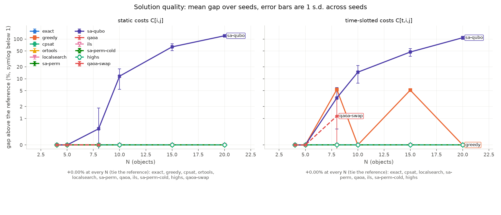
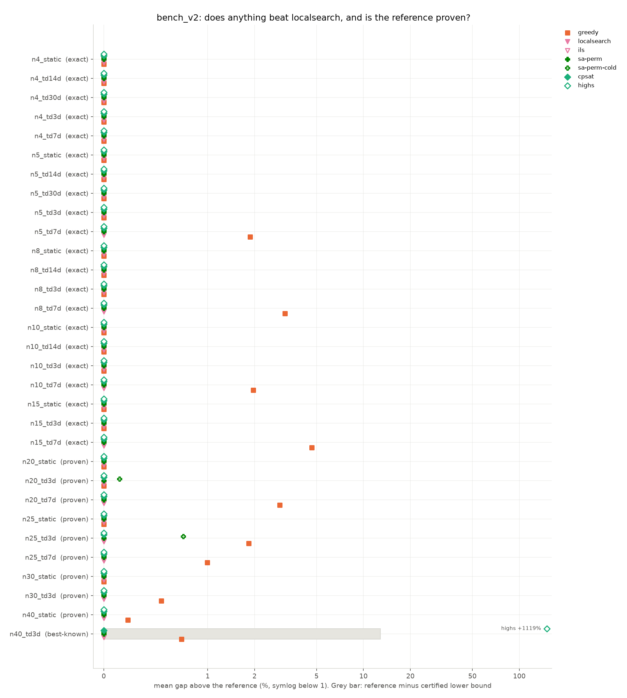
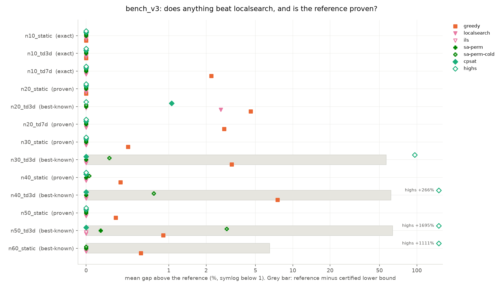
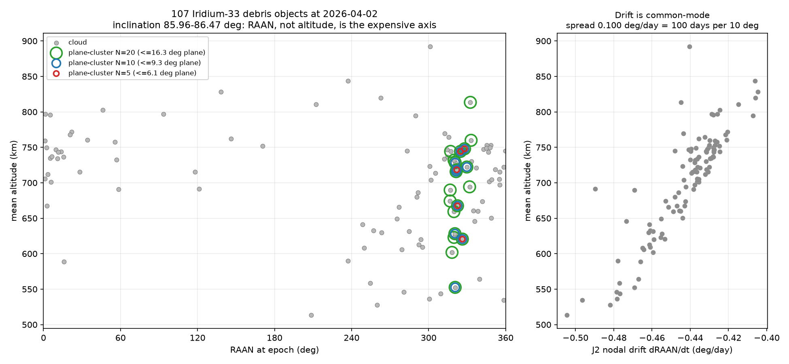
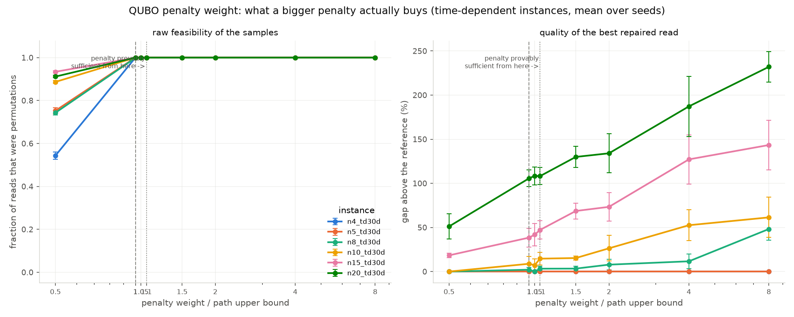
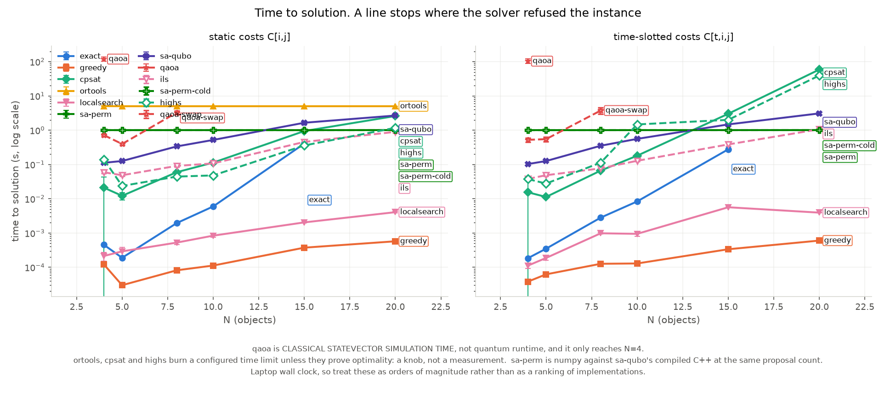
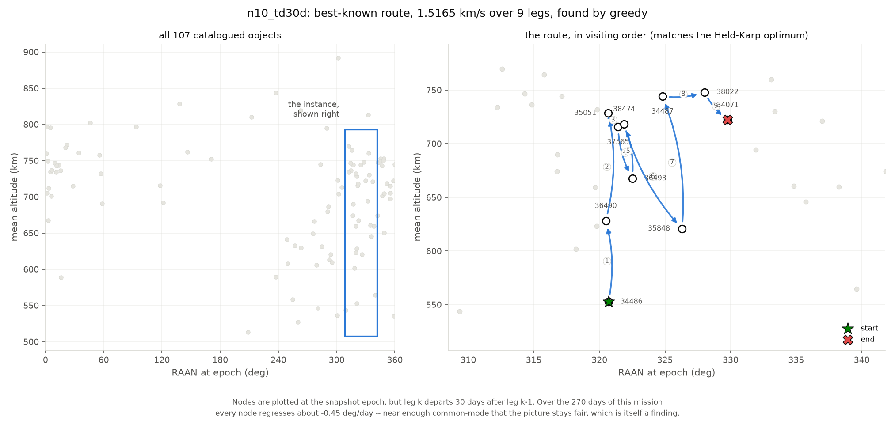

# Dextrivia

**An honest benchmark of classical, quantum-inspired and quantum solvers on a real orbital-debris sequencing problem.**

Given N catalogued fragments from the 2009 Iridium-33 / Cosmos-2251 collision
and a delta-v cost to transfer between any two, find the visiting order that
costs the least. The deliverable of this repository is **the comparison**, not
any one solver.

## The findings

1. **Real breakup clouds give near-one-dimensional instances, and on them greedy
   is often provably optimal.** This is the central result, not a footnote.
   * **Static v2 is exactly 1-D.** Visiting the objects in RAAN order (a sort,
     not a search) meets a certified lower bound on 8 of the 9 static v2
     instances, and is within 0.23% on the ninth. The objects share an
     inclination to 0.5°, so plane angle *is* RAAN difference.
   * **Static v3 is two strips crossed once.** Mixing both halves of the
     collision (86.4° and 74.0° inclination) adds one degree of freedom: which
     cloud to sweep first. Sweeping each cloud in RAAN order is within
     0.00–1.18% of a certified bound on all six static v3 instances.
   * **Greedy is provably optimal on 16 of the 21 static instances** across all
     three families, and within 0.66% on the other five.
   * Source: the pre-registered diagnostics in
     `docs/data/instance_diagnostics.json` (`docs/physics.md` §11), computed
     before any solver ran on v3.
2. **Every reference is now labelled exact, proven or best-known, with its
   certified lower bound.** Of 56 instances, 34 are *exact* (Held-Karp),
   16 are **proven** (a `highs` or `cpsat` certified bound meets the best path
   found), and 6 are best-known.
   * v1 `n20_td30d`, best-known in the previous canonical run, is now
     **proven** (3.6723 km/s).
   * v2 `n40_td3d` remains **best-known**: 5.7308 km/s against a bound of
     4.9953 km/s, a 12.83% gap.
3. **Localsearch is beaten on exactly one instance in the whole benchmark.**
   On v3 `n20_td3d`, localsearch is +2.63% above 6.9200 km/s. `ils`, `sa-perm`
   and `sa-perm-cold` reach 6.9200 on all 5 seeds; so does `highs`, and
   `cpsat` does on 3 of 5. It is the only measured headroom over a
   millisecond local search, and classical iterated local search and annealing
   recover it.
4. **v3 time-dependent at N ≥ 30 is unresolved: the bounds are too weak to
   certify it.** No solver beats localsearch on `n30_td3d`, `n40_td3d` or
   `n50_td3d`. The best-known paths sit 56.8–63.8% above the certified bounds.
   The evidence favours **bound weakness over hidden headroom**:
   * On the four v3 time-dependent instances whose optimum is pinned (N=10 and
     20), the cut-LP bound alone is **30–70% below the true optimum**, and only
     branch-and-bound closed the gap.
   * At N ≥ 30, branch-and-bound added nothing within 60 s, so the certified
     bound *is* the cut LP. The 57–64% gaps sit inside the cut LP's known
     30–70% weakness.
   * No run of any solver beats localsearch there. The best run of each, over
     5 seeds where seeded, equals localsearch to the last digit.
   * What is not excluded: a few percent of headroom like `n20_td3d`'s 2.6%.
     `ils` hit its 30 s safety cap only at N=60.
5. **No quantum or quantum-inspired solver beats the classical baselines
   anywhere.** `sa-qubo` (simulated annealing on the penalty QUBO) is the worst
   search heuristic at every N ≥ 10 and refuses N > 40. Below that, greedy is
   worse than it on three time-dependent instances: v1 `n8_td30d`, v2
   `n5_td7d` and v2 `n8_td7d`. `qaoa` stops at N=4.
   `qaoa-swap` reaches N=9 only because its feasible subspace has N!
   amplitudes. All of their runtimes are **classical simulation time**.

Every cell below comes from a committed `summary.csv` and is printed by
`uv run python scripts/results_tables.py results/canonical results/canonical-v2 results/canonical-v3`.
Gap is the mean above the reference over 5 seeds, ± one standard deviation
where it is non-zero. `cpsat` runs one seed above N=20, marked "(1 seed)".
**Bold localsearch** marks the one instance where it is not at the reference.
`highs`' large gaps at N ≥ 40 are its unfinished branch-and-bound incumbents.
Its job there is the bound, and it has no warm start (`docs/bounds.md`).

### v1 — `planecluster-v1`, frozen, 12 instances (`results/canonical/`)

| instance | reference (km/s) | kind | certified bound | `greedy` | `localsearch` | `ils` | `sa-perm` | `sa-perm-cold` | `cpsat` | `highs` | `sa-qubo` |
|---|---|---|---|---|---|---|---|---|---|---|---|
| `n4_static` | 0.5946 | *exact* | Held-Karp | +0.00% | +0.00% | +0.00% | +0.00% | +0.00% | +0.00% | +0.00% | +0.00% |
| `n4_td30d` | 0.5205 | *exact* | Held-Karp | +0.00% | +0.00% | +0.00% | +0.00% | +0.00% | +0.00% | +0.00% | +0.00% |
| `n5_static` | 0.8296 | *exact* | Held-Karp | +0.00% | +0.00% | +0.00% | +0.00% | +0.00% | +0.00% | +0.00% | +0.00% |
| `n5_td30d` | 0.8314 | *exact* | Held-Karp | +0.00% | +0.00% | +0.00% | +0.00% | +0.00% | +0.00% | +0.00% | +0.00% |
| `n8_static` | 1.0824 | *exact* | Held-Karp | +0.00% | +0.00% | +0.00% | +0.00% | +0.00% | +0.00% | +0.00% | +0.61% ± 1.22 |
| `n8_td30d` | 1.1124 | *exact* | Held-Karp | +5.37% | +0.00% | +0.00% | +0.00% | +0.00% | +0.00% | +0.00% | +3.30% ± 2.70 |
| `n10_static` | 1.3268 | *exact* | Held-Karp | +0.00% | +0.00% | +0.00% | +0.00% | +0.00% | +0.00% | +0.00% | +11.64% ± 6.22 |
| `n10_td30d` | 1.5165 | *exact* | Held-Karp | +0.00% | +0.00% | +0.00% | +0.00% | +0.00% | +0.00% | +0.00% | +14.65% ± 6.95 |
| `n15_static` | 2.0151 | *exact* | Held-Karp | +0.00% | +0.00% | +0.00% | +0.00% | +0.00% | +0.00% | +0.00% | +63.57% ± 12.59 |
| `n15_td30d` | 2.1855 | *exact* | Held-Karp | +5.18% | +0.00% | +0.00% | +0.00% | +0.00% | +0.00% | +0.00% | +47.20% ± 10.27 |
| `n20_static` | 2.4485 | **proven** | 2.4485 (highs) | +0.00% | +0.00% | +0.00% | +0.00% | +0.00% | +0.00% | +0.00% | +121.04% ± 9.00 |
| `n20_td30d` | 3.6723 | **proven** | 3.6723 (highs) | +0.00% | +0.00% | +0.00% | +0.00% | +0.00% | +0.00% | +0.00% | +108.17% ± 9.67 |

### v2 — `planecluster-v2`, 31 instances (`results/canonical-v2/`)

| instance | reference (km/s) | kind | certified bound | `greedy` | `localsearch` | `ils` | `sa-perm` | `sa-perm-cold` | `cpsat` | `highs` | `sa-qubo` |
|---|---|---|---|---|---|---|---|---|---|---|---|
| `n4_static` | 0.1875 | *exact* | Held-Karp | +0.00% | +0.00% | +0.00% | +0.00% | +0.00% | +0.00% | +0.00% | +0.00% |
| `n4_td3d` | 0.1892 | *exact* | Held-Karp | +0.00% | +0.00% | +0.00% | +0.00% | +0.00% | +0.00% | +0.00% | +0.00% |
| `n4_td7d` | 0.1942 | *exact* | Held-Karp | +0.00% | +0.00% | +0.00% | +0.00% | +0.00% | +0.00% | +0.00% | +0.00% |
| `n4_td14d` | 0.1978 | *exact* | Held-Karp | +0.00% | +0.00% | +0.00% | +0.00% | +0.00% | +0.00% | +0.00% | +0.00% |
| `n4_td30d` | 0.1980 | *exact* | Held-Karp | +0.00% | +0.00% | +0.00% | +0.00% | +0.00% | +0.00% | +0.00% | +0.00% |
| `n5_static` | 0.2932 | *exact* | Held-Karp | +0.00% | +0.00% | +0.00% | +0.00% | +0.00% | +0.00% | +0.00% | +0.00% |
| `n5_td3d` | 0.2946 | *exact* | Held-Karp | +0.00% | +0.00% | +0.00% | +0.00% | +0.00% | +0.00% | +0.00% | +0.00% |
| `n5_td7d` | 0.2936 | *exact* | Held-Karp | +1.87% | +0.00% | +0.00% | +0.00% | +0.00% | +0.00% | +0.00% | +0.00% |
| `n5_td14d` | 0.2746 | *exact* | Held-Karp | +0.00% | +0.00% | +0.00% | +0.00% | +0.00% | +0.00% | +0.00% | +0.00% |
| `n5_td30d` | 0.2732 | *exact* | Held-Karp | +0.00% | +0.00% | +0.00% | +0.00% | +0.00% | +0.00% | +0.00% | +0.00% |
| `n8_static` | 0.8346 | *exact* | Held-Karp | +0.00% | +0.00% | +0.00% | +0.00% | +0.00% | +0.00% | +0.00% | +0.71% ± 1.42 |
| `n8_td3d` | 0.8123 | *exact* | Held-Karp | +0.00% | +0.00% | +0.00% | +0.00% | +0.00% | +0.00% | +0.00% | +0.33% ± 0.41 |
| `n8_td7d` | 0.7676 | *exact* | Held-Karp | +3.14% | +0.00% | +0.00% | +0.00% | +0.00% | +0.00% | +0.00% | +1.25% ± 1.54 |
| `n8_td14d` | 0.7356 | *exact* | Held-Karp | +0.00% | +0.00% | +0.00% | +0.00% | +0.00% | +0.00% | +0.00% | +1.75% ± 3.50 |
| `n10_static` | 1.2731 | *exact* | Held-Karp | +0.00% | +0.00% | +0.00% | +0.00% | +0.00% | +0.00% | +0.00% | +10.09% ± 9.97 |
| `n10_td3d` | 1.2993 | *exact* | Held-Karp | +0.00% | +0.00% | +0.00% | +0.00% | +0.00% | +0.00% | +0.00% | +10.55% ± 8.68 |
| `n10_td7d` | 1.3373 | *exact* | Held-Karp | +1.96% | +0.00% | +0.00% | +0.00% | +0.00% | +0.00% | +0.00% | +9.73% ± 4.47 |
| `n10_td14d` | 1.4102 | *exact* | Held-Karp | +0.00% | +0.00% | +0.00% | +0.00% | +0.00% | +0.00% | +0.00% | +23.43% ± 5.02 |
| `n15_static` | 1.9215 | *exact* | Held-Karp | +0.00% | +0.00% | +0.00% | +0.00% | +0.00% | +0.00% | +0.00% | +69.01% ± 21.26 |
| `n15_td3d` | 1.9484 | *exact* | Held-Karp | +0.00% | +0.00% | +0.00% | +0.00% | +0.00% | +0.00% | +0.00% | +55.78% ± 9.89 |
| `n15_td7d` | 2.0331 | *exact* | Held-Karp | +4.66% | +0.00% | +0.00% | +0.00% | +0.00% | +0.00% | +0.00% | +63.98% ± 15.50 |
| `n20_static` | 2.4123 | **proven** | 2.4123 (highs) | +0.00% | +0.00% | +0.00% | +0.00% | +0.00% | +0.00% | +0.00% | +116.06% ± 12.43 |
| `n20_td3d` | 2.5321 | **proven** | 2.5321 (highs) | +0.00% | +0.00% | +0.00% | +0.00% | +0.15% ± 0.30 | +0.00% | +0.00% | +109.23% ± 9.25 |
| `n20_td7d` | 2.6467 | **proven** | 2.6467 (highs) | +2.90% | +0.00% | +0.00% | +0.00% | +0.00% | +0.00% | +0.00% | +126.54% ± 14.63 |
| `n25_static` | 3.5864 | **proven** | 3.5864 (highs) | +0.00% | +0.00% | +0.00% | +0.00% | +0.00% | +0.00% (1 seed) | +0.00% | +159.85% ± 17.32 |
| `n25_td3d` | 3.6015 | **proven** | 3.6015 (highs) | +1.83% | +0.00% | +0.00% | +0.00% | +0.76% ± 1.53 | +0.00% (1 seed) | +0.00% | +182.78% ± 18.83 |
| `n25_td7d` | 3.6630 | **proven** | 3.6630 (highs) | +1.00% | +0.00% | +0.00% | +0.00% | +0.00% | +0.00% (1 seed) | +0.00% | +158.50% ± 23.42 |
| `n30_static` | 4.5135 | **proven** | 4.5135 (highs) | +0.00% | +0.00% | +0.00% | +0.00% | +0.00% | +0.00% (1 seed) | +0.00% | +225.86% ± 34.48 |
| `n30_td3d` | 4.5952 | **proven** | 4.5952 (highs) | +0.55% | +0.00% | +0.00% | +0.00% | +0.00% | +0.00% (1 seed) | +0.00% | +227.52% ± 17.50 |
| `n40_static` | 5.5281 | **proven** | 5.5281 (highs) | +0.23% | +0.00% | +0.00% | +0.00% | +0.00% | +0.00% (1 seed) | +0.00% | +327.38% ± 33.13 |
| `n40_td3d` | 5.7308 | best-known | 4.9953 (highs), gap 12.83% | +0.75% | +0.00% | +0.00% | +0.00% | +0.00% | +0.00% (1 seed) | +1118.69% | +353.08% ± 19.35 |

### v3 — `collisionpair-v3`, 13 instances (`results/canonical-v3/`)

| instance | reference (km/s) | kind | certified bound | `greedy` | `localsearch` | `ils` | `sa-perm` | `sa-perm-cold` | `cpsat` | `highs` | `sa-qubo` |
|---|---|---|---|---|---|---|---|---|---|---|---|
| `n10_static` | 2.3605 | *exact* | Held-Karp | +0.00% | +0.00% | +0.00% | +0.00% | +0.00% | +0.00% | +0.00% | +3.74% ± 2.39 |
| `n10_td3d` | 3.1784 | *exact* | Held-Karp | +0.00% | +0.00% | +0.00% | +0.00% | +0.00% | +0.00% | +0.00% | +6.50% ± 1.15 |
| `n10_td7d` | 5.7322 | *exact* | Held-Karp | +2.20% | +0.00% | +0.00% | +0.00% | +0.00% | +0.00% | +0.00% | +2.84% ± 1.42 |
| `n20_static` | 3.9575 | **proven** | 3.9575 (highs) | +0.00% | +0.00% | +0.00% | +0.00% | +0.00% | +0.00% | +0.00% | +71.72% ± 11.87 |
| `n20_td3d` | 6.9200 | best-known | 6.9200 (cpsat), gap 0.00015% | +4.56% | **+2.63%** | +0.00% | +0.00% | +0.00% | +1.05% ± 1.29 | +0.00% | +34.66% ± 6.74 |
| `n20_td7d` | 12.6266 | **proven** | 12.6265 (highs) | +2.79% | +0.00% | +0.00% | +0.00% | +0.00% | +0.00% | +0.00% | +27.30% ± 1.30 |
| `n30_static` | 5.1700 | **proven** | 5.1700 (highs) | +0.51% | +0.00% | +0.00% | +0.00% | +0.00% | +0.00% (1 seed) | +0.00% | +201.82% ± 17.73 |
| `n30_td3d` | 10.1677 | best-known | 4.3932 (highs), gap 56.79% | +3.21% | +0.00% | +0.00% | +0.00% | +0.28% ± 0.56 | +0.00% (1 seed) | +96.31% | +97.63% ± 4.91 |
| `n40_static` | 6.2776 | **proven** | 6.2776 (highs) | +0.42% | +0.00% | +0.00% | +0.00% | +0.04% ± 0.07 | +0.00% (1 seed) | +0.00% | +298.86% ± 23.81 |
| `n40_td3d` | 13.4336 | best-known | 5.1076 (highs), gap 61.98% | +7.51% | +0.00% | +0.00% | +0.00% | +0.82% ± 1.64 | +0.00% (1 seed) | +266.03% | +149.74% ± 17.79 |
| `n50_static` | 7.2836 | **proven** | 7.2836 (highs) | +0.36% | +0.00% | +0.00% | +0.00% | +0.00% | +0.00% (1 seed) | +0.00% | refused |
| `n50_td3d` | 16.1235 | best-known | 5.8367 (highs), gap 63.80% | +0.93% | +0.00% | +0.00% | +0.18% ± 0.32 | +2.92% ± 5.66 | +0.00% (1 seed) | +1695.08% | refused |
| `n60_static` | 8.4777 | best-known | 7.9255 (highs), gap 6.51% | +0.66% | +0.00% | +0.00% | +0.00% | +0.00% | refused | +1111.29% | refused |

Notes on v3:
* **`n20_td3d` is best-known by a hair.** `cpsat`'s seed-4 run reports status
  OPTIMAL, and its certified bound is 1.0e-5 km/s below the path, a gap of
  0.00015%. The pre-registered "proven" tolerance is also 1e-5 km/s. At N=20
  cpsat's own rounding margin is 9.5e-6 km/s, so its certified bound cannot
  come closer than this. The label is reported as the rule produced it;
  see the open items in the PR.
* **`n60_static` is certified optimal, just not by the benchmark run.** The
  bench's `highs` (60 s) stopped at a bound of 7.9255 km/s. The pre-registered
  untimed cut LP gives 8.47773953 km/s, which is the best-known path minus the
  1e-6 km/s safety margin. It is recorded in
  [`docs/data/instance_diagnostics.json`](docs/data/instance_diagnostics.json),
  at `v3 → instances → label "n60_static" → lp_bound_dv`, and was committed in
  `2c74b46` before any solver ran on v3.
* `ortools` (static instances only) is not in the table. It ties the reference
  on every v1 and v2 static instance. On v3 static it is +2.24% at N=20,
  +1.41% at N=40, +3.66% at N=50 and +0.42% at N=60.

### Simulated quantum solvers, where they run

`qaoa` refuses N > 4 (the qubit wall) and `qaoa-swap` refuses N > 9. Both
refuse every v3 instance. Runtime is labelled by its `runtime_kind`: it is
**classical simulation time on a laptop**, not a quantum runtime, and no
quantum hardware was involved.

| family | instance | solver | gap (mean ± sd) | runtime (mean ± sd) | runtime kind | feasibility |
|---|---|---|---|---|---|---|
| canonical | `n4_static` | `qaoa` | +0.00% | 118.67 s ± 16.52 | classical statevector simulation time | 0.034 (measured) |
| canonical | `n4_static` | `qaoa-swap` | +0.00% | 0.72 s ± 0.07 | classical subspace simulation time | 1.000 (structural, subspace backend) |
| canonical | `n4_td30d` | `qaoa` | +0.00% | 103.49 s ± 16.17 | classical statevector simulation time | 0.027 (measured) |
| canonical | `n4_td30d` | `qaoa-swap` | +0.00% | 0.52 s ± 0.07 | classical subspace simulation time | 1.000 (structural, subspace backend) |
| canonical | `n5_static` | `qaoa-swap` | +0.00% | 0.40 s ± 0.03 | classical subspace simulation time | 1.000 (structural, subspace backend) |
| canonical | `n5_td30d` | `qaoa-swap` | +0.00% | 0.55 s ± 0.08 | classical subspace simulation time | 1.000 (structural, subspace backend) |
| canonical | `n8_static` | `qaoa-swap` | +0.00% | 3.27 s ± 0.40 | classical subspace simulation time | 1.000 (structural, subspace backend) |
| canonical | `n8_td30d` | `qaoa-swap` | +1.15% ± 2.31 | 3.75 s ± 0.77 | classical subspace simulation time | 1.000 (structural, subspace backend) |
| canonical-v2 | `n4_static` | `qaoa` | +0.00% | 93.09 s ± 11.52 | classical statevector simulation time | 0.038 (measured) |
| canonical-v2 | `n4_static` | `qaoa-swap` | +0.00% | 0.87 s ± 0.02 | classical subspace simulation time | 1.000 (structural, subspace backend) |
| canonical-v2 | `n4_td3d` | `qaoa` | +0.00% | 84.50 s ± 9.80 | classical statevector simulation time | 0.038 (measured) |
| canonical-v2 | `n4_td3d` | `qaoa-swap` | +0.00% | 0.61 s ± 0.06 | classical subspace simulation time | 1.000 (structural, subspace backend) |
| canonical-v2 | `n4_td7d` | `qaoa` | +0.00% | 76.86 s ± 5.94 | classical statevector simulation time | 0.040 (measured) |
| canonical-v2 | `n4_td7d` | `qaoa-swap` | +0.00% | 0.60 s ± 0.11 | classical subspace simulation time | 1.000 (structural, subspace backend) |
| canonical-v2 | `n4_td14d` | `qaoa` | +0.00% | 75.60 s ± 12.52 | classical statevector simulation time | 0.042 (measured) |
| canonical-v2 | `n4_td14d` | `qaoa-swap` | +0.00% | 0.41 s ± 0.01 | classical subspace simulation time | 1.000 (structural, subspace backend) |
| canonical-v2 | `n4_td30d` | `qaoa` | +0.00% | 65.47 s ± 7.54 | classical statevector simulation time | 0.040 (measured) |
| canonical-v2 | `n4_td30d` | `qaoa-swap` | +0.00% | 0.42 s ± 0.02 | classical subspace simulation time | 1.000 (structural, subspace backend) |
| canonical-v2 | `n5_static` | `qaoa-swap` | +0.00% | 0.67 s ± 0.08 | classical subspace simulation time | 1.000 (structural, subspace backend) |
| canonical-v2 | `n5_td3d` | `qaoa-swap` | +0.00% | 0.53 s ± 0.05 | classical subspace simulation time | 1.000 (structural, subspace backend) |
| canonical-v2 | `n5_td7d` | `qaoa-swap` | +0.00% | 0.67 s ± 0.10 | classical subspace simulation time | 1.000 (structural, subspace backend) |
| canonical-v2 | `n5_td14d` | `qaoa-swap` | +0.00% | 0.43 s ± 0.00 | classical subspace simulation time | 1.000 (structural, subspace backend) |
| canonical-v2 | `n5_td30d` | `qaoa-swap` | +0.00% | 0.51 s ± 0.02 | classical subspace simulation time | 1.000 (structural, subspace backend) |
| canonical-v2 | `n8_static` | `qaoa-swap` | +0.00% | 3.29 s ± 0.10 | classical subspace simulation time | 1.000 (structural, subspace backend) |
| canonical-v2 | `n8_td3d` | `qaoa-swap` | +0.00% | 3.79 s ± 0.43 | classical subspace simulation time | 1.000 (structural, subspace backend) |
| canonical-v2 | `n8_td7d` | `qaoa-swap` | +0.00% | 4.11 s ± 0.61 | classical subspace simulation time | 1.000 (structural, subspace backend) |
| canonical-v2 | `n8_td14d` | `qaoa-swap` | +0.00% | 3.52 s ± 0.46 | classical subspace simulation time | 1.000 (structural, subspace backend) |

At N ≤ 4 a `+0.00%` here is **not evidence of anything**. There are 24
orderings, and best-of-shots finds the optimum from noise. See "Where QAOA
stands" below for the measurement against chance. `qaoa-swap`'s feasibility
of 1.000 is **structural**: the subspace backend cannot leave the feasible set.
It was not measured.







---

## The problem, and why it matters

The 2009 Iridium-33 / Cosmos-2251 collision left more than 2,000 trackable
fragments in low Earth orbit. Active debris removal — sending a servicer to
capture several of them in one mission — is limited by propellant, so the
*order* in which targets are visited decides whether a mission is affordable.

The mission is an **open path, not a TSP tour**. The servicer starts at the
first object of the sequence and stops at the last. There is no return leg and
no depot, so a sequence over N objects has exactly **N-1 legs**. This matters
more than it sounds: the textbook TSP QUBO would charge the mission for a leg it
never flies, and every solver, cost model and formulation here is written
against the open-path definition.

Sequencing is NP-hard in general, which is what makes it a standard candidate
for quantum and quantum-inspired optimisation — and what makes an honest
classical baseline mandatory before anyone says the word "advantage".

---

## The physics model, and what it assumes

Full write-up: **[`docs/physics.md`](docs/physics.md)**.

Each object's orbit comes from its TLE, propagated with SGP4 to a common epoch —
the snapshot's **median TLE epoch**, never a hardcoded date. Transfer cost is a
two-burn impulsive manoeuvre between circular orbits at each object's **mean
semi-major axis**, with the plane change folded into the burns and the split
between them solved numerically rather than assumed.

The single fact that shapes everything:

| Quantity | This cloud |
|---|---|
| Mean altitude | 513 – 892 km |
| Inclination | 85.96° – 86.47° (spread **0.51°**) |
| RAAN | **the full circle** |
| Median pairwise plane angle | **45.5°** |
| Impulsive cost of that median plane change at 700 km | **5.80 km/s** |

Inclination alone says the cloud is one orbit. RAAN says it is 107 of them.
The exchange rate at 700 km is **1° of plane ≈ 0.131 km/s** against **100 km of
altitude ≈ 0.053 km/s** — both matter, which is exactly what makes the
sequencing non-trivial.



Because a median leg costs more than a launch to GEO, full-cloud tours are
physically absurd. Instances are built by a **`plane-cluster` rule** fixed before
any solver runs: keep the objects nearest a seed object in true plane angle.
The rule never looks at delta-v, let alone at which solver wins on the result.

**Time dependence.** J2 makes the orbital nodes regress. Leg *k* is priced at
`epoch + k · 30 days`, so a `td30d` instance carries a cost array `C[t,i,j]`
where `t` is the position of the leg in the sequence. The drift here is
**common-mode** (−0.405 to −0.505 °/day), so it largely cancels: the
*differential* rate for a median pair is 0.016 °/day, i.e. **612 days to change
their separation by 10°**. Waiting buys very little, and this repository does
not pretend otherwise.

### What the model still ignores

Phasing (the largest omission — the servicer is assumed to arrive at the right
point in the target's orbit for free), three-burn bi-elliptic transfers (so
every large-angle cost is an upper bound), eccentricity, finite burns and
gravity losses, time windows, propellant budget, vehicle constraints, and
conjunction-risk weighting. None of these exist here.

---

## Why the first version of this project was wrong

This repository began as an altitude-only tool. Three things were wrong with it,
and all three are visible in the git history rather than reconstructed.

**1. The propagation ran ~15 months backward.** `text_cost_matrix.py` in
[`e837989`](../../commit/e837989) hardcoded `datetime(2025, 1, 1, 12, 0, 0)`
while the TLE set's median epoch is `2026-04-02T07:05:22Z` — **455 days, 14.9
months, in the wrong direction**. SGP4 is a *fitted* model whose accuracy decays
away from its own epoch in either direction. Propagating this snapshot back to
that date moves mean altitudes by +20.0 km on average and up to 108 km, and
SGP4 refuses outright (error 6, decayed) on 1 of the 107 objects. The epoch is
now a parameter that defaults to the snapshot's median TLE epoch, and there are
no hardcoded calendar dates anywhere in the package.

**2. Altitude was the instantaneous radius, with the wrong Earth.**
`propagation.py` computed `|r| − 6371 km`. Two errors stacked: `|r|` oscillates
once per orbit (about 285 km peak-to-peak for the most eccentric object here),
and 6371 km is the mean spherical radius while SGP4 works internally in WGS72
(6378.135 km). Against the mean semi-major axis the old figure disagrees by
+8.9 km on average and up to **144 km** per object — encoding "where the object
happened to be at the chosen instant" into a cost matrix that is supposed to
describe its orbit. Altitude is now `Satrec.am`, the mean semi-major axis, with
WGS72 throughout.

**3. The benchmark was degenerate, which is the one that actually mattered.**
The coplanar Hohmann model derives every cost from **one scalar per object**.
Objects on a single scalar axis lie on a line, so the cheapest open path is just
"visit them in altitude order" — a sort. Nearest-neighbour greedy finds that
sort, so greedy tied the exact Held-Karp optimum at **0.1262 km/s** on the
10-object instance, and no solver of any kind could have demonstrated anything.
A benchmark where the baseline is provably optimal measures nothing.

This is locked down rather than deleted: [`tests/test_degeneracy.py`](tests/test_degeneracy.py)
still asserts that sorting by altitude *is* optimal under the altitude-only
model, so the degeneracy cannot quietly return. The plane-aware model made
altitude order **56–339% worse than optimal** on every instance in the committed
family, which is what created the headroom this benchmark measures.

---

## The QUBO formulation

Full write-up: **[`docs/qubo.md`](docs/qubo.md)**.

One binary per (object, position) pair, `x[i,p] = 1` when object *i* is visited
*p*-th, so **N² variables**:

```
H(x) = H_obj(x) + A · H_pen(x)

H_obj(x) = sum over p in 0..N-2 of  sum_ij  C_p[i,j] · x[i,p] · x[j,p+1]
H_pen(x) = sum_i (1 - sum_p x[i,p])²  +  sum_p (1 - sum_i x[i,p])²
```

The objective sum runs to `N-2`, giving **N-1 terms** — the open path again, no
wrap-around. `C_p` is `instance.leg_costs(p)`, so a time-slotted instance needs
no extra machinery: the QUBO's position index and the instance's time slot are
the same integer, and a time-dependent instance produces a QUBO of exactly the
same shape.

The penalty weight `A` is set to `1.1 × L_greedy`, a computable upper bound on
the optimum: since `H_pen ≥ 1` on anything that is not a permutation matrix and
`H_obj ≥ 0`, any `A > L*` makes every infeasible assignment worse than the
optimum. On a feasible assignment the energy is *exactly* the path cost in km/s.

**Raw and repaired results are kept apart everywhere.** `repair()` cannot fail,
so a repaired delta-v always exists; quoting it as a sampler result would make a
sampler that never once satisfied a constraint look successful.

---

## Conclusions

### Where simulated annealing stands

`sa-qubo` (simulated annealing on the QUBO) is the worst search heuristic in
this benchmark at every N ≥ 10, and it degrades with N.
* **v1:** +0.61% at N=8, +11.64% at N=10, +63.57% at N=15 and +121.04% at N=20
  (static); +3.30%, +14.65%, +47.20% and +108.17% (time-dependent).
* **v2 at N=40:** +327.38% static and +353.08% time-dependent.
* **v3 at N=40:** +298.86% and +149.74%.
* It refuses N > 40.

The reason is **the encoding, not the annealer**. `sa-perm` anneals the same
objective over permutations, instead of over N² penalised binaries, and ties
the reference on every v1 and v2 instance. Its only miss in the whole
benchmark is +0.18% mean on v3 `n50_td3d`. `sa-perm` gets a **1 second
wall-clock budget** across 4 restarts. `sa-qubo`'s 500 reads × 1000 sweeps cost
it 0.10–3.09 s on v1, in compiled C++ (`dwave-samplers`), against interpreted
Python. The comparison is generous to `sa-qubo`.

**The greedy head start is now measured, not stated.** `sa-perm` starts its
first restart from the greedy path. `sa-perm-cold` is identical but starts
every restart from a random permutation.
* They tie on every v1 instance and on every instance below N=20.
* Cold starts cost something only on large time-dependent instances:
  * v2 `n20_td3d`: +0.15% ± 0.30
  * v2 `n25_td3d`: +0.76% ± 1.53
  * v3 `n30_td3d`: +0.28%
  * v3 `n40_static`: +0.04%
  * v3 `n40_td3d`: +0.82%
  * v3 `n50_td3d`: +2.92% ± 5.66, against +0.18% warm
* So the head start is worth something only at N ≥ 20, mostly with
  time-dependent costs. Even there it is not decisive: on v3 `n20_td3d`, cold
  and warm both reach the best-known path on all 5 seeds. The old caveat that
  "part of `sa-perm`'s +0.00% is the head start" holds only on the instances
  listed above.

### Where QAOA stands

**QAOA runs at N=4 and nowhere else in this benchmark.** The position encoding
needs N² qubits, and a dense statevector holds 2^(N²) amplitudes: 512 MB at
N=5 before the optimiser evaluates anything, and 1 TB at N=6. `exact`, a 1962
dynamic program, reaches N=18 on the same laptop. **The quantum solver's
ceiling sits an order of magnitude below the classical oracle's, on the same
problem, in the same encoding.**

At N=4 the +0.00% gap **is not evidence of anything**. There are 24 possible
sequences among 2^16 bitstrings, so best-of-4096-shots plus repair recovers the
optimum from uniform random bits. The only numbers at this size that carry
signal are the ones measured against chance (v1, 5 seeds):

| instance | raw feasibility | uniform baseline | P(optimal bitstring) | uniform P(optimal) | mean Δv of feasible samples | mean Δv of a random permutation |
|---|---|---|---|---|---|---|
| `n4_static` | **0.0344** ± 0.0251 | 0.000366 | **0.0049** ± 0.0041 | 0.0000305 (2 optimal sequences) | 0.9586 km/s | 1.0261 km/s |
| `n4_td30d` | **0.0270** ± 0.0229 | 0.000366 | **0.0016** ± 0.0017 | 0.0000153 (1 optimal sequence) | 0.9103 km/s | 0.9735 km/s |

Read honestly, that is one real effect and one disappointment:

* **QAOA concentrates amplitude on the feasible subspace**, by about 94× on the
  static instance and 74× on the time-dependent one, and on the optimal
  bitstring by 162× and 102×. The uniform baselines are exact counts, not
  estimates.
* **Within the feasible set it barely optimises.** The mean delta-v of its
  feasible samples is only 6.6% and 6.5% better than a uniformly random
  permutation. It finds permutations, not good permutations.

`qaoa-swap` (constraint-preserving mixer, `docs/qubo.md` §10) runs to N=9.
That reach comes from the problem's size, not from anything quantum: the
circuit's feasible subspace has N! amplitudes, which a classical simulator
evolves exactly. It ties the reference on every instance it runs except v1
`n8_td30d` (+1.15% ± 2.31). As with `qaoa` at N ≤ 4, best-of-shots there is not
evidence; `docs/qubo.md` has the within-feasible quality study.

**Every QAOA runtime here is classical simulation time.** For `qaoa` that is
statevector time: 118.67 s ± 16.52 per run on v1 `n4_static`, 103.49 s ± 16.17
on `n4_td30d`. For `qaoa-swap` it is subspace time: 0.40–4.11 s mean per run. No
quantum hardware was involved.

### Where the MIPs stand: CP-SAT and HiGHS

Both are time-indexed MIPs that read `C[t,i,j]` through the slot index, so
neither has `ortools`' blind spot for time-dependent costs.

* **`highs` is what certifies the references.** It proves optimality on 12/12
  v1, 30/31 v2 and 8/13 v3 instances. Every `proven` reference in the tables
  rests on its bound.
* **`cpsat`, warm-started from localsearch with a redundant circuit
  constraint,** proves optimality on 56/60 v1, 125/127 v2 and 23/36 v3 runs.
  Its bounds carry a (N−1)·0.5 mm/s rounding margin.
* Both runtimes are a **configured 60 s limit** unless the run proves
  optimality. That is a knob, not a measurement.
* Full write-up, including the cap study and the CP-SAT ablation:
  [`docs/bounds.md`](docs/bounds.md).

`ortools` (routing, guided local search) cannot express time-dependent costs
and refuses all of them with a reason.
* It ties every v1 and v2 static reference.
* On v3 static it loses: +2.24% at N=20, +1.41% at N=40, +3.66% at N=50 and
  +0.42% at N=60.

`localsearch` (greedy start, then 2-opt and or-opt) ties the reference on 55
of 56 instances. Its mean runtime is at most 0.07 s on every instance. `ils`
(the same descent plus double-bridge kicks and restarts) **matches the
reference on all 56**, including the one localsearch misses. It cannot do worse
than localsearch by construction. Its cost is runtime: up to 11.5 s at N=40, 22.8 s
at N=50, and its 30 s cap at N=60.

### The penalty study

`DEFAULT_PENALTY_SAFETY = 1.1` was calibrated on one easy instance. Across all
six time-dependent instances × 5 seeds × 8 weights, **it is dominated
everywhere**. Gap above the reference, mean over 5 seeds:

| instance | 0.5 | 1.0 | 1.05 | **1.1** | 1.5 | 2.0 | 4.0 | 8.0 |
|---|---|---|---|---|---|---|---|---|
| `n4_td30d` | +0.0 | +0.0 | +0.0 | **+0.0** | +0.0 | +0.0 | +0.0 | +0.0 |
| `n5_td30d` | +0.0 | +0.0 | +0.0 | **+0.0** | +0.0 | +0.0 | +0.0 | +0.0 |
| `n8_td30d` | +0.0 | +2.1 | +0.0 | **+3.3** | +3.4 | +7.9 | +11.6 | +48.2 |
| `n10_td30d` | +0.0 | +8.8 | +7.2 | **+14.7** | +15.3 | +26.4 | +52.6 | +61.4 |
| `n15_td30d` | +18.4 | +38.5 | +41.8 | **+47.2** | +68.7 | +73.4 | +127.2 | +143.4 |
| `n20_td30d` | +51.2 | +105.7 | +108.5 | **+108.2** | +129.9 | +134.0 | +187.2 | +232.0 |



Two things follow, and they point the same way:

1. **A bigger penalty buys no feasibility.** Raw feasibility is already 0.996–1.000
   at weight 1.0 on every instance, and stays there through 8.0. Below the
   threshold it falls to 0.54–0.93 — and the *quality* there is the best on the
   whole table. The bound is worst-case; "provably sufficient" and "works well"
   are different properties.
2. **A bigger penalty costs quality, monotonically.** At `n15_td30d` the shipped
   default is nearly three times worse than weight 0.5. Raising the penalty
   compresses the objective into the numerical shadow of the constraint terms,
   and the sampler loses the ability to tell a good path from a mediocre one.

The default should be swept per instance rather than trusted. This does not
rescue `sa-qubo`: even its best weight at `n15_td30d` (+18.4%) is far worse than
`sa-perm`, `localsearch` and `cpsat`, all of which reach the optimum there.

### Time to solution



Read these with the caveats printed on the figure:
* `qaoa` and `qaoa-swap` times are classical simulation time.
* `ortools`, `cpsat` and `highs` burn a configured limit unless they prove
  optimality.
* `sa-perm` is numpy against `sa-qubo`'s compiled C++.
* `ils` has a 30 s safety cap, which it reached only on v3 `n60_static`.

These are laptop wall-clock numbers. Treat them as orders of magnitude, not as
a ranking of implementations. The v2 and v3 runtime figures are
`docs/figures/bench_v2_runtime_vs_n.png` and `bench_v3_runtime_vs_n.png`.

### One route, drawn on the plane that costs delta-v



### What produced these numbers

| family | runs | solver runs at | results files written at |
|---|---|---|---|
| v1 | 588 | `fa5b562`, clean tree | `4a340e3` (CSV regeneration, no solver run) |
| v2 | 1491 | `fa5b562`, clean tree | `a8f15ea` (post-processing after a crash, no solver run) |
| v3 | 609 | `203f4e9`, clean tree | `203f4e9` |

The only `src/` change between `fa5b562` and `203f4e9` is in `bench.py`: the
log-space chance baselines, and the manifest field that records code changes.
It touches post-processing only. No solver, cost model or instance changed, so
all three families ran the same solver code. Each manifest's
`code_changes_since_runs` shows the diff for its own run, and each result row
carries the commit that produced it.

Two things went wrong on the way, and both are in the history:
* The v2 run crashed **after** all 1491 solver runs: computing the uniform
  chance baseline overflowed a float at N=40. It was fixed in `a8f15ea`, and
  the CSVs were written by a resume. Its checkpoint, `runs.jsonl`, was
  sha256-identical before and after.
* The first canonical run's `certified_lower_bound_kms` column was empty in
  every row, because the harness read a metadata key no solver writes.

Solution quality is deterministic given the seeds, with two exceptions:
`cpsat` runs 8 workers, and both MIPs are time-limited, so their results can
vary between machines. Wall clock is not deterministic. All three runs were
made on a laptop, and the v3 run was observed running under `caffeinate`.
Load average was not recorded per run, so treat runtimes as indicative.

### A note on where the solvers came from

`cpsat`, `localsearch` and `sa-perm` came from the classical-baselines
workspace. `highs`, `ils` and `sa-perm-cold` were added for this comparison
(`docs/bounds.md`), and `qaoa-swap` came from the QUBO workspace (`docs/qubo.md`
§10). `sa-perm`'s budget is matched to `sa-qubo` by wall clock rather than by
proposals, which makes the result depend on the machine; the 1 s budget is
recorded in every row's metadata.

## Reproduce it

From a clean clone, the three canonical runs, with the figures and tables
regenerated from them:

```bash
uv sync --all-extras
uv run dextrivia bench --out results/my-v1                       # v1 + penalty study, ~35 min
uv run dextrivia bench --instance-dir data/instances/planecluster-v2 \
    --out results/my-v2 --no-penalty-study                       # v2, ~1 h
uv run dextrivia bench --instance-dir data/instances/collisionpair-v3 \
    --out results/my-v3 --no-penalty-study                       # v3, ~40 min
uv run python scripts/plot_benchmark.py results/my-v1 --prefix bench
uv run python scripts/results_tables.py results/my-v1 results/my-v2 results/my-v3
```

Every run is resumable. Re-run the same command with the same `--out` and
completed rows are kept; each row records the git commit that produced it.

A quick run, for checking the harness rather than reproducing the numbers:

```bash
uv run dextrivia bench --instances n4 --solvers greedy,exact,cpsat --seeds 1 --no-penalty-study
```

The degenerate altitude-only baseline from "Why the first version of this
project was wrong", point 3. The snapshot is pinned: `dextrivia build` without
`--snapshot` takes the newest one, which would change the number.
`tests/test_readme_example.py` runs this block and checks the quoted output.

```bash
uv run dextrivia build --snapshot data/snapshots/iridium33_20260402.json --n 10
uv run dextrivia solve --instance data/instances/iridium33_20260402_n10_first.npz --solver exact
# total dv   0.126246 km/s
```

Tests, lint and format:

```bash
uv run pytest
uv run ruff check . && uv run ruff format --check .
```

Everything the benchmark needs is committed: the TLE snapshots
(`data/snapshots/`), the three instance families (`data/instances/` for v1,
`planecluster-v2/` and `collisionpair-v3/`), and the three canonical runs
(`results/canonical/`, `results/canonical-v2/`, `results/canonical-v3/`). No
network access is required to reproduce any number in this README.

### What a results directory contains

| File | Contents |
|---|---|
| `runs.jsonl` | the checkpoint: one JSON row per finished run, appended as it completes; what a resume reads |
| `results.csv` | one row per (instance, solver, seed) run |
| `summary.csv` | one row per (instance, solver): mean, standard deviation, best |
| `penalty_sweep.csv` | QUBO feasibility and quality against penalty weight |
| `manifest.json` | git SHA, per-instance sha256, library versions, CPU, seeds, run segments, `code_changes_since_runs` |

**`results/canonical/penalty_sweep.csv` is from the original v1 run at
`fa5b562`, penalty study included.** That directory's `manifest.json`
`command` shows `--no-penalty-study`, but only because the other CSVs and the
manifest were regenerated later by a resume that ran no solver, to add the
`log10_uniform_*` columns. The flag stopped the penalty study, which isn't
checkpointed, from being re-sampled. `penalty_sweep.csv` was left
byte-identical, and the manifest's `notes` field says so. The v2 and v3 runs
have no penalty study by design.

---

## Repository layout

```
src/dextrivia/
|-- core.py                 ProblemInstance / CostModel / Solver / Solution
|-- propagation.py          SGP4 wrapper, mean semi-major axis at an epoch
|-- snapshots.py            fetch / load / select immutable TLE snapshots
|-- instances.py            snapshot + selection + cost model -> instance
|-- bench.py                the benchmark harness
|-- cli.py                  dextrivia fetch | build | solve | bench
|-- costs/                  hohmann (baseline), realistic (plane-aware), selection
|-- qubo/                   open-path QUBO: formulation, decode, repair, penalty
|-- solvers/                greedy, exact, brute, localsearch, ils, sa-perm,
|                           sa-perm-cold, sa-qubo, qaoa, qaoa-swap, ortools,
|                           cpsat, highs (certified lower bounds)
data/snapshots/             committed, timestamped TLE sets
data/instances/             v1 (flat), planecluster-v2/, collisionpair-v3/
results/canonical*/         the committed v1, v2 and v3 runs this README cites
scripts/                    instance family, figures, benchmark output check
docs/physics.md             the cost models and their validation
docs/qubo.md                the QUBO formulation and its characterization
docs/bounds.md              certified lower bounds, the MIP caps, the CP-SAT ablation
```

---

## Data sources

| Source | Description | License |
|--------|-------------|---------|
| [Celestrak](https://celestrak.org) | TLE catalog, Iridium-33 debris group | Free for non-commercial use |

TLEs are fetched from Celestrak's `gp.php` endpoint using the
`iridium-33-debris` group. No API key is required. Snapshots are immutable:
`dextrivia fetch` always writes a new file and never overwrites one, so a
benchmark can cite a filename.

The committed snapshot's `fetched_utc` is `null` — it predates the packaged
fetcher, which never recorded a download time. Inventing one would be worse than
admitting the gap.

---

## License

MIT. See [`LICENSE`](LICENSE).

## Acknowledgments

- [sgp4](https://pypi.org/project/sgp4/) by Brandon Rhodes, implementing the Vallado SGP4 formulation.
- [Celestrak](https://celestrak.org), maintained by T.S. Kelso.
- [D-Wave `dwave-samplers`](https://github.com/dwavesystems/dwave-samplers), [Qiskit](https://www.ibm.com/quantum/qiskit) and [Google OR-Tools](https://developers.google.com/optimization).
